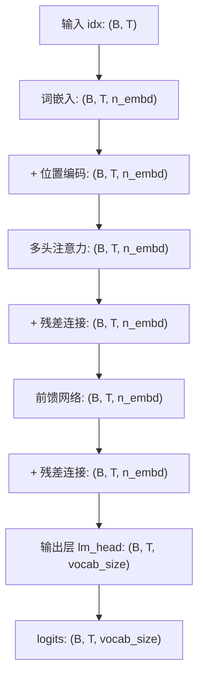

# Mini-GPT 项目终极复习手册

> **使用说明**：本手册按“概念 → 算法/公式 → 代码对应 → 关键要点”四列结构组织，方便你快速查阅和对照代码。代码路径均以项目根目录 `mini_gpt/` 为基准。


## 第一章：数据准备与向量化

### 1.1 字符级分词 (Character-Level Tokenization)

| 维度 | 内容 |
| :--- | :--- |
| **概念** | 把原始文本拆成最基础的字符单元，每个字符分配一个唯一的整数ID |
| **算法** | `chars = sorted(list(set(text)))` → 建立 `stoi`（字符→ID）和 `itos`（ID→字符）映射表 → `data = [stoi[ch] for ch in text]` |
| **代码对应** | `src/dataset.py` → `CharDataset.__init__()` |
| **关键要点** | 这是“万物向量化”的第一步：**文字 → 数字**。真实大模型会用BPE等更复杂的分词算法，但原理相同。 |

### 1.2 词嵌入 (Token Embedding)

| 维度 | 内容 |
| :--- | :--- |
| **概念** | 把离散的字符ID映射成稠密的连续向量，让语义相似的字符在向量空间中靠近 |
| **算法** | `embedding = nn.Embedding(vocab_size, n_embd)` → 输入ID查表得到向量：`tok_emb = embedding(idx)` |
| **代码对应** | `src/model.py` → `MiniGPT.__init__()` 中的 `self.token_embedding` |
| **关键要点** | 嵌入矩阵是可学习的，形状为 `(vocab_size, n_embd)`。初始随机，训练中通过反向传播不断优化。 |

### 1.3 位置编码 (Positional Encoding)

| 维度 | 内容 |
| :--- | :--- |
| **概念** | 给每个位置的token注入位置信息，因为Self-Attention本身对顺序不敏感 |
| **算法** | `pos_emb = position_embedding(pos)` → `x = tok_emb + pos_emb`（直接相加） |
| **代码对应** | `src/model.py` → `MiniGPT.forward()` 中的 `self.position_embedding` |
| **关键要点** | 采用**可学习式位置编码**（Learnable），形状为 `(block_size, n_embd)`，随模型一起训练。 |


## 第二章：注意力机制

### 2.1 单头自注意力 (Self-Attention Head)

| 维度 | 内容 |
| :--- | :--- |
| **概念** | 让每个位置的token都能“关注”到所有其他位置（受因果掩码约束），根据相关性加权汇总信息 |
| **算法** | `Q = x @ W_Q^T`, `K = x @ W_K^T`, `V = x @ W_V^T` → `scores = Q @ K^T / √d_k` → `weights = softmax(scores)` → `out = weights @ V` |
| **代码对应** | `src/model.py` → `Head.forward()` |
| **关键要点** | Q、K、V来自同一输入（Self-Attention）。`W_Q`、`W_K`、`W_V` 是**独立的可学习权重矩阵**。`√d_k` 是缩放因子，防止点积值过大导致梯度消失。 |

### 2.2 因果掩码 (Causal Masking)

| 维度 | 内容 |
| :--- | :--- |
| **概念** | 确保预测第 `t` 个位置时，只能看到位置 `0` 到 `t-1`，不能“偷看”未来信息 |
| **算法** | `tril = torch.tril(torch.ones(T, T))` → `scores.masked_fill(tril == 0, -inf)` → Softmax后未来位置权重变为0 |
| **代码对应** | `src/model.py` → `Head.forward()` 中的 `masked_fill` |
| **关键要点** | 这是**因果语言模型（Causal LM）** 的核心，保证了自回归生成的合法性。 |

### 2.3 多头注意力 (Multi-Head Attention)

| 维度 | 内容 |
| :--- | :--- |
| **概念** | 并行运行多个独立的注意力头，每个头从不同角度（子空间）关注信息，最后拼接融合 |
| **算法** | `heads_out = [head(x) for head in heads]` → `concat = torch.cat(heads_out, dim=-1)` → `out = concat @ W_O^T` |
| **代码对应** | `src/model.py` → `MultiHeadAttention.forward()` |
| **关键要点** | 每个头有自己的 `W_Q`、`W_K`、`W_V`，互不相同。`head_size = n_embd // n_head`，总计算量与单头相近但效果更好。 |


## 第三章：Transformer 核心组件

### 3.1 前馈网络 (FeedForward)

| 维度 | 内容 |
| :--- | :--- |
| **概念** | 对每个位置的token独立做非线性变换，增强模型的表达能力 |
| **算法** | `FFN(x) = ReLU(x @ W_1^T + b_1) @ W_2^T + b_2`（代码中省略了偏置） |
| **代码对应** | `src/model.py` → `FeedForward.forward()` |
| **关键要点** | 典型结构：**线性 → ReLU → 线性**，中间维度放大4倍（`4 * n_embd`）。每个位置独立计算，不跨位置共享信息。 |

### 3.2 层归一化 (LayerNorm)

| 维度 | 内容 |
| :--- | :--- |
| **概念** | 对单个样本的所有特征做标准化，使均值接近0、方差接近1，稳定训练 |
| **算法** | `mean = mean(x)`, `var = var(x)` → `x_norm = (x - mean) / sqrt(var + eps)` → `out = γ * x_norm + β` |
| **代码对应** | `src/model.py` → `Block` 中的 `nn.LayerNorm` |
| **关键要点** | 与BatchNorm不同，LayerNorm在**特征维度**上归一化，与批次大小无关，更适合RNN/Transformer。 |

### 3.3 残差连接 (Residual Connection)

| 维度 | 内容 |
| :--- | :--- |
| **概念** | 把输入直接加到子层输出上，形成“高速公路”，缓解深层网络的梯度消失问题 |
| **算法** | `out = x + sublayer(x)` |
| **代码对应** | `src/model.py` → `Block.forward()` 中的 `x = x + self.sa(self.ln1(x))` |
| **关键要点** | 残差连接 + LayerNorm 是Transformer能够堆叠几十上百层的基石。 |

### 3.4 Transformer Block

| 维度 | 内容 |
| :--- | :--- |
| **概念** | 一个完整的Transformer层，按顺序组合：LayerNorm → 多头注意力 → 残差 → LayerNorm → 前馈网络 → 残差 |
| **算法** | `x = x + MHA(LN(x))` → `x = x + FFN(LN(x))` |
| **代码对应** | `src/model.py` → `Block.forward()` |
| **关键要点** | 这是**Pre-Norm**架构（先LayerNorm再子层），比原始Post-Norm更稳定，是现代大模型的标准做法。 |


## 第四章：训练核心算法

### 4.1 交叉熵损失 (Cross-Entropy Loss)

| 维度 | 内容 |
| :--- | :--- |
| **概念** | 衡量模型预测的概率分布与真实标签之间的差距，是分类任务最常用的损失函数 |
| **算法** | `loss = -log(softmax(logits)[target])`，对批次内所有样本取平均 |
| **代码对应** | `src/model.py` → `MiniGPT.forward()` 中的 `F.cross_entropy` |
| **关键要点** | `logits` 形状 `(B, T, vocab_size)` 需要展平为 `(B*T, vocab_size)`，`targets` 展平为 `(B*T,)`。 |

### 4.2 反向传播 (Backpropagation)

| 维度 | 内容 |
| :--- | :--- |
| **概念** | 利用链式法则，从损失函数开始，逆向计算每个可学习参数对损失的偏导数（梯度） |
| **算法** | `∂L/∂w = ∂L/∂out * ∂out/∂w`（链式法则逐层传递） |
| **代码对应** | `src/trainer.py` → `train_step()` 中的 `loss.backward()` |
| **关键要点** | PyTorch的自动微分（Autograd）机制自动构建计算图并计算梯度。执行前需要 `optimizer.zero_grad()` 清空旧梯度。 |

### 4.3 梯度下降与优化器 (Optimizer)

| 维度 | 内容 |
| :--- | :--- |
| **概念** | 沿着梯度的反方向调整参数，使损失函数值逐步下降 |
| **算法** | 标准SGD：`w_new = w - lr * ∂L/∂w`。AdamW增加动量和自适应学习率 |
| **代码对应** | `src/trainer.py` → `train_step()` 中的 `optimizer.step()` |
| **关键要点** | 本代码使用 **AdamW**，核心改进是将权重衰减与损失函数解耦。 |


## 第五章：训练流程控制

### 5.1 学习率调度 (Learning Rate Scheduling)

| 维度 | 内容 |
| :--- | :--- |
| **概念** | 训练过程中动态调整学习率，前期线性预热防止震荡，后期余弦退火精细调优 |
| **算法** | 预热：`lr = base_lr * (step+1) / warmup_iters`；余弦退火：`lr = 0.5 * base_lr * (1 + cos(π * progress))` |
| **代码对应** | `src/trainer.py` → `get_lr()` |
| **关键要点** | 预热能防止初始梯度方向不准确时步子过大；余弦退火让后期更新更平滑。 |

### 5.2 梯度裁剪 (Gradient Clipping)

| 维度 | 内容 |
| :--- | :--- |
| **概念** | 将所有参数的梯度整体缩放到一个安全范数范围内，防止梯度爆炸 |
| **算法** | 计算所有梯度的L2范数 `total_norm`，如果 `total_norm > max_norm`，所有梯度乘以 `max_norm / total_norm` |
| **代码对应** | `src/trainer.py` → `train_step()` 中的 `clip_grad_norm_` |
| **关键要点** | 基于**整体范数**裁剪，保持不同参数间的相对更新比例不变。 |

### 5.3 权重衰减 (Weight Decay)

| 维度 | 内容 |
| :--- | :--- |
| **概念** | 在参数更新时额外惩罚权重本身的大小，防止模型过拟合 |
| **算法** | AdamW更新公式：`w_new = w - lr * (m_hat/(√v_hat+ε) + weight_decay * w)` |
| **代码对应** | `src/trainer.py` → `_create_optimizer()` 中的 `param_groups` |
| **关键要点** | 权重矩阵应用权重衰减，偏置和归一化层不应用。这是AdamW的标准实践。 |

### 5.4 训练-验证-保存循环

| 维度 | 内容 |
| :--- | :--- |
| **概念** | 训练过程中定期在验证集上评估，并保存最优模型检查点 |
| **算法** | 每 `eval_interval` 步调用 `evaluate()` → 如果 `val_loss < best_val_loss`，保存为 `best.pt` |
| **代码对应** | `src/trainer.py` → `train()` 主循环 |
| **关键要点** | 验证集损失是判断模型泛化能力的关键指标，用于挑选最优检查点。 |


## 第六章：数据流与张量形状

### 6.1 完整的前向传播数据流



### 6.2 关键张量形状速查表

| 张量 | 形状 | 说明 |
| :--- | :--- | :--- |
| `idx` | `(B, T)` | 输入的字符ID序列 |
| `targets` | `(B, T)` | 目标字符ID序列（`idx` 右移一位） |
| `tok_emb` | `(B, T, n_embd)` | 词嵌入后的向量 |
| `pos_emb` | `(1, T, n_embd)` | 位置编码 |
| `x` | `(B, T, n_embd)` | 经过各层的隐藏状态 |
| `q, k, v` | `(B, T, head_size)` | Query、Key、Value |
| `scores` | `(B, T, T)` | 注意力分数矩阵 |
| `weights` | `(B, T, T)` | Softmax后的注意力权重 |
| `logits` | `(B, T, vocab_size)` | 最终的预测分数（未归一化） |


## 第七章：超参数全景图

| 超参数 | 默认值 | 类型 | 作用 |
| :--- | :--- | :--- | :--- |
| `block_size` | 64 | 模型架构 | 上下文窗口长度（一次能看多少个字符） |
| `n_embd` | 128 | 模型架构 | 嵌入向量的维度 |
| `n_head` | 4 | 模型架构 | 多头注意力的头数 |
| `n_layer` | 4 | 模型架构 | Transformer层的堆叠数量 |
| `dropout` | 0.1 | 模型架构 | Dropout比例，防止过拟合 |
| `batch_size` | 32 | 训练 | 每个批次包含的样本数 |
| `max_iters` | 3000 | 训练 | 最大训练步数 |
| `learning_rate` | 1e-3 | 训练 | 参数更新的步长 |
| `weight_decay` | 1e-4 | 训练 | L2正则化强度 |
| `gradient_clip` | 1.0 | 训练 | 梯度裁剪的阈值 |
| `eval_interval` | 100 | 训练 | 验证频率（步数） |
| `save_interval` | 500 | 训练 | 检查点保存频率 |


## 第八章：常用PyTorch API速查

| API | 用途 | 本代码中的使用 |
| :--- | :--- | :--- |
| `nn.Module` | 所有神经网络层的基类 | `Head`, `MultiHeadAttention`, `MiniGPT` 等全部继承自它 |
| `nn.Linear` | 全连接层（线性变换） | `self.key = nn.Linear(...)` 等，用于生成Q/K/V和FFN |
| `nn.Embedding` | 词嵌入层（查表） | `self.token_embedding` 和 `self.position_embedding` |
| `nn.LayerNorm` | 层归一化 | `self.ln1`, `self.ln2`, `self.ln_f` |
| `nn.Dropout` | 随机失活（正则化） | `self.dropout`，训练时随机置零部分神经元 |
| `nn.Sequential` | 顺序容器，按顺序执行子模块 | `FeedForward.net` 和 `MiniGPT.blocks` |
| `F.softmax` | 将分数转为概率分布 | 注意力权重的归一化 |
| `F.cross_entropy` | 计算交叉熵损失 | `MiniGPT.forward()` 中计算损失 |
| `torch.cat` | 沿指定维度拼接张量 | `MultiHeadAttention` 中拼接多个头的输出 |
| `masked_fill` | 将满足条件的元素置为指定值 | 因果掩码中将未来位置置为 `-inf` |
| `register_buffer` | 注册不参与训练的持久化张量 | `self.register_buffer('tril', ...)` |
| `model.train()` | 切换到训练模式 | 启用Dropout |
| `model.eval()` | 切换到评估模式 | 禁用Dropout |
| `@torch.no_grad()` | 禁用梯度计算 | `evaluate()` 和 `generate()` 中节省显存 |
| `torch.save` / `torch.load` | 保存/加载检查点 | `save_checkpoint()` / `load_checkpoint()` |


## 第九章：完整代码调用链

### 9.1 训练调用链
```
train.py (main)
    ↓
Trainer.__init__()
    ↓ 创建优化器 _create_optimizer()
    ↓
Trainer.train()
    ↓ 循环执行
    ├── train_step()
    │   ├── get_lr() → 计算当前学习率
    │   ├── get_batch() → 采样数据
    │   ├── model(x, y) → 前向传播
    │   │   ├── token_embedding + position_embedding
    │   │   ├── Block.forward()
    │   │   │   ├── MultiHeadAttention.forward()
    │   │   │   │   └── Head.forward() × n_head
    │   │   │   └── FeedForward.forward()
    │   │   └── lm_head → logits + 损失计算
    │   ├── loss.backward() → 反向传播
    │   ├── clip_grad_norm_() → 梯度裁剪
    │   └── optimizer.step() → 参数更新
    ├── evaluate() → 验证集评估
    └── save_checkpoint() → 保存检查点
```

### 9.2 生成调用链
```
generate.py (main)
    ↓
torch.load() → 加载检查点
    ↓
model = MiniGPT(config) → 重建模型
    ↓
model.load_state_dict() → 加载参数
    ↓
Generator.generate()
    ↓
model.generate()
    ├── 循环 max_tokens 次
    │   ├── model(idx_cond) → 前向传播
    │   ├── temperature 缩放
    │   ├── top_k 过滤
    │   ├── softmax → 概率分布
    │   └── multinomial → 随机采样
    └── 返回完整ID序列
```


## 第十章：常见问题速答

| 问题 | 答案 |
| :--- | :--- |
| `block_size` 是什么？ | 序列长度 `T`，即模型一次能处理的字符数 |
| `n_embd` 是什么？ | 嵌入向量维度，每个字符用多少维向量表示 |
| `vocab_size` 是什么？ | 词典大小，即模型能预测的候选字符总数 |
| 为什么要除以 `√d_k`？ | 缩放点积值，防止Softmax梯度消失 |
| `Q` 和 `K` 相等吗？ | 不相等。它们由独立的权重矩阵 `W_Q` 和 `W_K` 生成 |
| 为什么 `targets = idx` 右移一位？ | 语言模型任务是“根据上文预测下文”，每个位置的正确答案就是下一个字符 |
| 为什么需要因果掩码？ | 防止模型在预测时“偷看”未来的字符，保证自回归性 |
| 检查点保存了什么？ | 模型参数、优化器状态、训练步数、配置、字符映射表 |
| 如何选择最佳模型？ | 比较验证集损失 `val_loss`，最低的那个是best |
| 训练时模型在做什么？ | 最小化交叉熵损失，即让预测的概率分布尽可能接近真实分布 |


**手册结束**

这份手册涵盖了我们对话中涉及的所有核心概念、算法和代码对应关系。如果你发现某个章节还需要补充具体的手算例子或更详细的代码行号映射，随时告诉我，我可以继续扩展。
